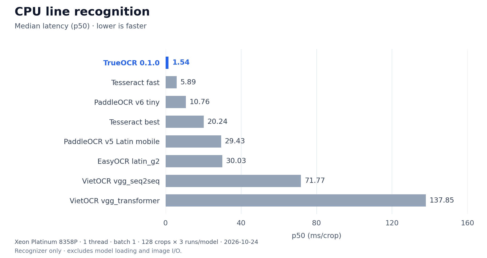

# Benchmark CPU

Đo ngày **24/10/2026**, TrueOCR **0.1.0** từ source của repo. Các engine
chạy trong cùng phiên đo; TrueOCR dùng `model.recognizer.predict()`.

## Crop recognition latency



| Model | p50, ms/crop ↓ | p95, ms/crop ↓ | p50 / TrueOCR |
|---|---:|---:|---:|
| TrueOCR 0.1.0 | 1.54 | 2.35 | 1.0× |
| Tesseract fast | 5.89 | 15.29 | 3.8× |
| PaddleOCR v6 tiny | 10.76 | 12.29 | 7.0× |
| Tesseract best | 20.24 | 49.06 | 13.2× |
| PaddleOCR v5 Latin mobile | 29.43 | 30.79 | 19.1× |
| EasyOCR latin_g2 | 30.03 | 68.90 | 19.5× |
| VietOCR vgg_seq2seq | 71.77 | 98.01 | 46.7× |
| VietOCR vgg_transformer | 137.85 | 231.45 | 89.7× |

`p50 / TrueOCR` là tỷ lệ median latency. Ví dụ 19.5× nghĩa là p50 của
model đó bằng 19.5 lần p50 TrueOCR trong phép đo này. Không phải tỷ lệ
throughput khi chạy batch hay nhiều request đồng thời.

## Benchmark setup

- VM Linux dùng chung, Intel Xeon Platinum 8358P @ 2.60 GHz.
- Các engine chạy tuần tự, dùng CPU affinity 31; 1 thread, batch 1.
- Model load một lần và warm-up trước khi đo. Tesseract giữ engine trong RAM.
- Cùng 128 crop, cùng thứ tự, lặp 3 lượt: **384 request/model, 0 lỗi runtime**.
- Latency gồm adapter, preprocessing, inference và text decoding. Image I/O,
  model initialization, ghi file và hiển thị nằm ngoài vòng đo.

128 crop gồm 26 crop nội bộ, 96 crop có controlled degradation, 3 từ VinText
và 3 dòng UIT-HWDB. Đây là timing cohort nhỏ, có tỷ trọng ảnh biến dạng cao;
không đại diện cho mọi phân bố tài liệu. Con số trên đo recognizer; chưa
đo end-to-end latency của mode `page` trong package TrueOCR hiện tại.

## Baseline config

| Model | Runtime và config |
|---|---|
| TrueOCR | ONNX Runtime 1.31.0, FP32, CTC greedy |
| [Tesseract](https://github.com/tesseract-ocr/tesseract) | 5.5.1 qua tesserocr 2.11.0; tessdata fast/best, `vie+eng`, OEM 1, PSM 7 |
| [PaddleOCR](https://github.com/PaddlePaddle/PaddleOCR) | Paddle 3.2.2, oneDNN bật; `latin_PP-OCRv5_mobile_rec` và `PP-OCRv6_tiny_rec`, native CTC |
| [EasyOCR](https://github.com/JaidedAI/EasyOCR) | 1.7.2, PyTorch 2.9.1; `vi+en`, `latin_g2`, CPU quantization, greedy; không nạp detector |
| [VietOCR](https://github.com/pbcquoc/vietocr) | 0.3.13, PyTorch 2.9.1; `vgg_seq2seq` / `vgg_transformer`, greedy, max generated length 128 |

Đây là so sánh các checkpoint/runtime cụ thể, không phải mọi config của
mỗi thư viện. Môi trường ONNX, Paddle và Torch tách riêng; package versions,
checksum weights, code và từng timing nằm trong
[cpu-20261024.json](benchmarks/cpu-20261024.json). Có thể tính lại p50/p95 từ
mảng `models[].predict_ms`.

Vẽ lại chart từ repo root: `python docs/benchmarks/plot_cpu.py` (cần `matplotlib`).

## Recognition accuracy

Đánh giá recognizer TrueOCR trên 32.549 crop, batch 32. Áp dụng Unicode NFC
normalization và gộp whitespace; giữ nguyên hoa/thường, dấu và dấu câu. Exact match là tỷ lệ
khớp toàn dòng/từ; CER là tổng edit distance chia tổng ký tự tham chiếu.

| Dataset | Crop | Exact match ↑ | CER ↓ |
|---|---:|---:|---:|
| Crop nội bộ: ID fields + legacy | 22.280 | 96.60% | 0.68% |
| VinText unseen test: scene text | 10.068 | 41.25% | 35.59% |
| UIT-HWDB: handwriting render từ stroke | 201 | 0.00% | 74.41% |

Dataset nội bộ có 12.564 crop ID fields và 9.716 crop trong bucket legacy
`receipt`. Nguồn của bucket này chưa được xác minh là hóa đơn thực. Dataset đã
được dùng trong các vòng R&D, chưa phải independent production gold set. VinText
là scene text crop; UIT-HWDB là ảnh render từ stroke, không phải ảnh chụp
trang viết tay.

Các điểm trên chỉ đo crop recognition. Mode `page` còn phụ thuộc detector,
orientation và reading order. Số đếm và checksum của lượt đánh giá nằm trong
[quality-20261024.json](benchmarks/quality-20261024.json).

## Đo trên crop của bạn

Đặt crop một dòng vào `crops/`. Đọc ảnh trước vòng đo và tái sử dụng model:

```python
from pathlib import Path
from time import perf_counter

import cv2
import numpy as np
from trueocr import load_model

cv2.setNumThreads(1)
images = [cv2.imread(str(p)) for p in sorted(Path("crops").glob("*.png"))]
assert images and all(image is not None for image in images)
model = load_model(mode="line", threads=1)
for image in images[:3]:
    model.recognizer.predict([image], batch_size=1)

times = []
for _ in range(3):
    for image in images:
        started = perf_counter()
        model.recognizer.predict([image], batch_size=1)
        times.append((perf_counter() - started) * 1000)

p50, p95 = np.percentile(times, [50, 95])
print(f"p50={p50:.2f} ms, p95={p95:.2f} ms")
```

Muốn so baseline, dùng cùng ảnh và thread/core budget; giữ model trong
RAM và đo từng engine riêng. Muốn đo `page`, tính thời gian quanh
`model.predict(image)` trên ảnh đầy đủ rồi báo thành bảng riêng.

Harness nhiều engine và phần ảnh nội bộ của bảng trên chưa được đóng gói
trong repo này. JSON lưu config, checksum và số đo để kiểm tra kết quả;
đoạn code trên phục vụ đo TrueOCR với dữ liệu của bạn.
